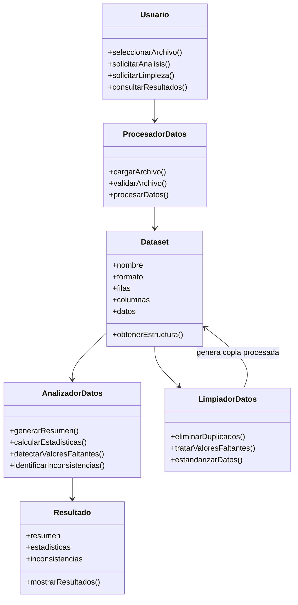
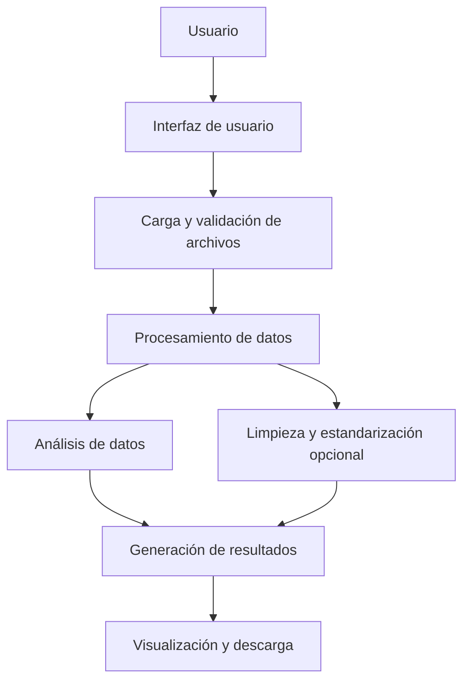
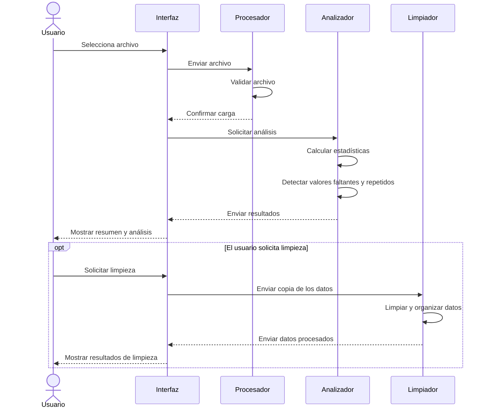

# PRÁCTICA 8. MODELADO UML DEL SISTEMA.
**Proyecto:** DataDoc.  
**Nombre:** Plataforma de Procesamiento, Estandarización y Análisis de Datos.
**Asignatura:** Ingeniería de Software.  
**Unidad:** 1. Cierre Sumativo.  
**Documento:** Modelado UML. 
**Versión:** 1.0  
**Fecha:** 21/10/2026

## 1. Introducción.
El presente documento muestra el modelado UML de DataDoc, una plataforma que permitirá cargar, procesar y analizar conjuntos de datos.

El modelado UML sirve para representar de manera visual cómo estará organizado el sistema, cuáles serán sus partes principales y cómo interactuarán entre sí.

Para ello, se utilizarán diferentes diagramas que servirán como guía durante el diseño y desarrollo del software.

## 2. Objetivo del modelado.
Representar la estructura y el funcionamiento de DataDoc mediante diagramas que permitan entender cómo se organiza el sistema, qué funciones tendrá cada parte y cómo se relacionan sus componentes.

## 3. Arquitectura general del sistema.
DataDoc tendrá una estructura dividida en cuatro partes principales:

1. **Interfaz de usuario:** permite cargar archivos y consultar los resultados.
2. **Procesamiento de datos:** se encarga de leer y preparar la información de los archivos.
3. **Análisis de datos:** obtiene estadísticas, genera resúmenes y detecta posibles problemas.
4. **Limpieza y estandarización:** permite realizar cambios opcionales en una copia de los datos.

Esta organización permitirá que cada parte tenga una función específica y sea más fácil realizar cambios, pruebas y mejoras.

## 4. Diagrama de clases.
### 4.1 Descripción:
El diagrama de clases muestra los elementos principales que tendrá DataDoc, sus características, funciones y la relación que existe entre ellos.
Las clases propuestas son:

- **Usuario:** representa a la persona que utiliza el sistema.
- **Dataset:** contiene la información del archivo que se carga.
- **ProcesadorDatos:** se encarga de leer y preparar los archivos.
- **AnalizadorDatos:** obtiene estadísticas, genera resúmenes y detecta problemas.
- **LimpiadorDatos:** realiza las operaciones opcionales de limpieza.
- **Resultado:** almacena la información obtenida durante el análisis.

### 4.2 Representación UML:

## 5. Diagrama de componentes.
### 5.1 Descripción:
El diagrama de componentes muestra cómo se divide DataDoc en diferentes partes para realizar sus funciones.
Cada componente tendrá una responsabilidad:

- **Interfaz:** permite al usuario utilizar el sistema.
- **Carga de archivos:** permite seleccionar y validar los archivos CSV y Excel.
- **Procesamiento:** prepara la información para poder analizarla.
- **Análisis:** obtiene estadísticas y genera resúmenes.
- **Limpieza:** permite corregir y organizar los datos cuando el usuario lo solicita.
- **Presentación:** muestra los resultados obtenidos y permite consultar las opciones disponibles para descargarlos.

### 5.2 Representación UML:

## 6. Diagrama de secuencia.
### 6.1 Descripción:
El diagrama de secuencia muestra los pasos que sigue el sistema cuando el usuario carga y analiza un archivo.
Primero, el usuario selecciona un archivo. Después, el sistema revisa que sea válido, procesa su información y realiza el análisis para obtener estadísticas y detectar posibles problemas.
La limpieza de los datos será opcional y solamente se realizará si el usuario decide utilizarla.

### 6.2 Representación UML:

## 7. Relación entre los diagramas.
Los tres diagramas muestran diferentes partes del funcionamiento de DataDoc:
| Diagrama | Propósito | Aplicación en DataDoc |
|---|---|---|
| Clases | Mostrar la estructura del sistema. | Define las clases y las funciones de cada una. |
| Componentes | Mostrar cómo se organiza el sistema. | Identifica los módulos principales. |
| Secuencia | Mostrar cómo interactúan las partes. | Explica los pasos para cargar y analizar un archivo. |

## 8. Consideraciones de diseño.
Para desarrollar DataDoc se tomarán en cuenta los siguientes aspectos:
- **Modularidad:** dividir el sistema en partes para facilitar su desarrollo y mantenimiento.
- **Reutilización:** crear funciones que puedan utilizarse en diferentes partes del sistema.
- **Integridad de los datos:** conservar los archivos originales y realizar la limpieza sobre una copia.
- **Separación de responsabilidades:** hacer que cada módulo tenga una función específica.
- **Posibilidad de crecimiento:** permitir agregar nuevos formatos y funciones en futuras versiones.

## 9. Conclusión.
El modelado UML permite tener una idea más clara de cómo estará organizado y cómo funcionará DataDoc antes de comenzar su implementación.

El diagrama de clases muestra los elementos principales del sistema, el diagrama de componentes explica cómo se dividen sus funciones y el diagrama de secuencia representa los pasos que se siguen para analizar un archivo.
Estos diagramas servirán como guía para desarrollar el software de manera ordenada y facilitarán su programación, integración y realización de pruebas.

