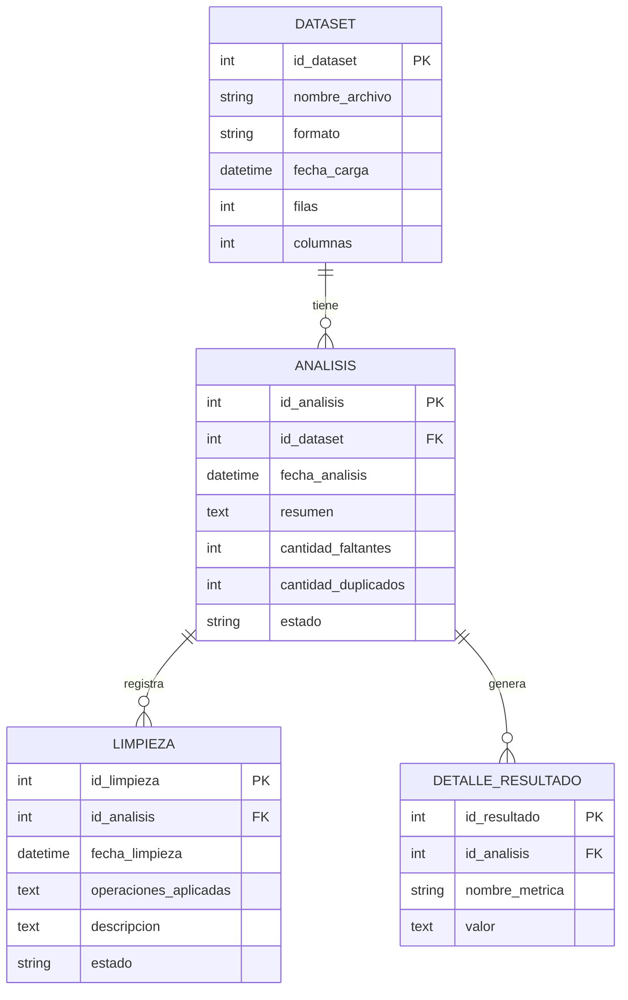

# DISEÑO DE BASE DE DATOS.
**Asignatura:** Ingeniería de Software  
**Proyecto Final:** Plataforma de Procesamiento, Estandarización y Análisis de Datos  
**Nombre del proyecto:** DataDoc  
**Documento:** Diseño de Base de Datos  

## 1. Introducción.
Este documento presenta una propuesta de diseño de base de datos para DataDoc, una plataforma que permitirá cargar, procesar y analizar conjuntos de datos.

La base de datos servirá para guardar información de los archivos cargados, los análisis realizados, los resultados obtenidos y las limpiezas aplicadas.

Esta propuesta está pensada para futuras versiones del sistema, ya que la primera versión podrá funcionar directamente con archivos locales sin necesitar una base de datos.

## 2. Objetivo de la base de datos.
Diseñar una estructura que permita guardar y organizar la información de los archivos y sus análisis.
Esto facilitará consultar resultados anteriores y llevar un registro de las operaciones realizadas.

## 3. Entidades principales.
Se proponen cuatro entidades principales para organizar la información.

### 3.1 Dataset.
Guarda la información general de cada archivo que se carga al sistema.
| Atributo | Tipo de dato | Descripción |
|---|---|---|
| id_dataset | INT | Identificador único del archivo (PK). |
| nombre_archivo | VARCHAR | Nombre del archivo cargado. |
| formato | VARCHAR | Formato del archivo, como CSV o XLSX. |
| fecha_carga | DATETIME | Fecha en que se cargó el archivo. |
| filas | INT | Cantidad de filas. |
| columnas | INT | Cantidad de columnas. |

### 3.2 Análisis.
Guarda la información de los análisis realizados a cada archivo.
| Atributo | Tipo de dato | Descripción |
|---|---|---|
| id_analisis | INT | Identificador único del análisis (PK). |
| id_dataset | INT | Archivo al que pertenece el análisis (FK). |
| fecha_analisis | DATETIME | Fecha en que se realizó el análisis. |
| resumen | TEXT | Resumen general de los resultados. |
| cantidad_faltantes | INT | Cantidad de datos faltantes. |
| cantidad_duplicados | INT | Cantidad de datos repetidos. |
| estado | VARCHAR | Estado del análisis. |

### 3.3 Limpieza.
Guarda las operaciones de limpieza que el usuario decida realizar sobre los datos.
| Atributo | Tipo de dato | Descripción |
|---|---|---|
| id_limpieza | INT | Identificador único de la limpieza (PK). |
| id_analisis | INT | Análisis relacionado (FK). |
| fecha_limpieza | DATETIME | Fecha en que se realizó la limpieza. |
| operaciones_aplicadas | TEXT | Limpiezas que se realizaron. |
| descripcion | TEXT | Explicación de los cambios realizados. |
| estado | VARCHAR | Estado de la operación. |

### 3.4 Detalle_Resultado.
Guarda las estadísticas y los resultados específicos que se obtienen durante el análisis.
| Atributo | Tipo de dato | Descripción |
|---|---|---|
| id_resultado | INT | Identificador único del resultado (PK). |
| id_analisis | INT | Análisis al que pertenece (FK). |
| nombre_metrica | VARCHAR | Nombre de la estadística o resultado. |
| valor | TEXT | Valor obtenido. |

## 4. Relaciones entre entidades.
Las tablas tendrán las siguientes relaciones:
- Un archivo puede tener varios análisis.
- Cada análisis pertenece a un solo archivo.
- Un análisis puede tener varias operaciones de limpieza.
- Un análisis puede generar varios resultados.
Estas relaciones permitirán organizar la información y consultar el historial de cada archivo.

## 5. Diagrama entidad-relación.
El siguiente diagrama muestra cómo se relacionan las cuatro entidades de la base de datos.

## 6. Llaves primarias y foráneas.
Las llaves primarias (PK) sirven para identificar cada registro de una tabla sin repetir su identificador.
Las llaves foráneas (FK) permiten conectar la información de una tabla con otra.

En este diseño se utilizarán de la siguiente manera:
- `id_dataset`: identifica cada archivo.
- `id_analisis`: identifica cada análisis.
- `id_limpieza`: identifica cada operación de limpieza.
- `id_resultado`: identifica cada resultado.
- `id_dataset` en la tabla ANALISIS permite saber a qué archivo pertenece cada análisis.
- `id_analisis` en las tablas LIMPIEZA y DETALLE_RESULTADO permite relacionar las limpiezas y los resultados con su análisis correspondiente.

## 7. Integridad y organización de los datos.
Para evitar errores y mantener la información organizada, se tomarán en cuenta las siguientes medidas:

- Cada registro tendrá un identificador único.
- Las tablas estarán relacionadas mediante llaves foráneas.
- No se podrán guardar análisis de archivos que no existan en la base de datos.
- Cada limpieza deberá estar relacionada con un análisis existente.
- Se conservará el archivo original para evitar perder la información antes de realizar cambios.

## 8. Justificación del diseño.
La base de datos se propone para organizar por separado la información de los archivos, los análisis, las limpiezas y los resultados.

Esta organización facilitará la consulta de información, el mantenimiento del sistema y la posibilidad de agregar nuevas funciones en el futuro.
Además, permitirá llevar un registro de las limpiezas realizadas sin modificar automáticamente los archivos originales.

## 9. Consideraciones para la implementación.
La base de datos no será necesaria para la primera versión de DataDoc, ya que el sistema podrá cargar y procesar archivos directamente.

Sin embargo, si se implementa en futuras versiones, permitirá:
- Consultar análisis anteriores.
- Guardar un historial de archivos procesados.
- Revisar las estadísticas obtenidas.
- Consultar las operaciones de limpieza realizadas.
- Dar seguimiento a los resultados de cada archivo.

## 10. Conclusión.
El diseño de la base de datos propone una forma organizada de guardar la información generada por DataDoc.

Su implementación en futuras versiones permitirá conservar un historial de los archivos, consultar análisis anteriores y revisar las operaciones de limpieza realizadas.
De esta manera, la base de datos podrá ampliar las funciones del sistema y facilitar el manejo de la información.
