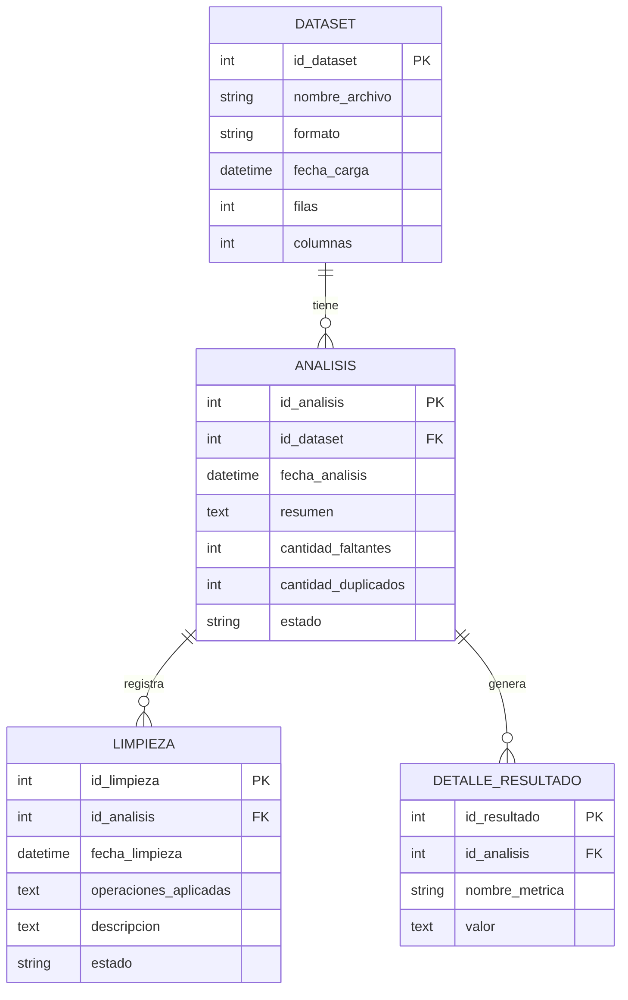

# Diseño de Base de Datos
**Asignatura:** Ingeniería de Software  
**Proyecto Final:** Plataforma de Procesamiento, Estandarización y Análisis de Datos  
**Equipo de Desarrollo:** Datermos  
**Documento:** Diseño de Base de Datos  

---

## 1. Introducción

El presente documento describe el diseño de la base de datos propuesta para Datermos, un sistema que permite procesar, analizar y estandarizar diferentes tipos de datasets.

La base de datos tiene como finalidad almacenar información relacionada con los archivos procesados, los análisis realizados, los resultados obtenidos y las operaciones de limpieza aplicadas.

Este diseño se considera una propuesta para futuras versiones del sistema, ya que la primera versión podrá trabajar directamente con archivos locales sin requerir una base de datos.

## 2. Objetivo de la base de datos

Diseñar una estructura que permita almacenar y organizar la información generada durante el procesamiento y análisis de los datasets, facilitando la consulta de resultados y la conservación de un historial de operaciones.

## 3. Entidades principales

Se proponen las siguientes entidades:

### 3.1 Dataset

Almacena los datos generales de cada archivo que se carga al sistema.

| Atributo | Tipo de dato | Descripción |
|---|---|---|
| id_dataset | INT | Identificador único del dataset (PK). |
| nombre_archivo | VARCHAR | Nombre del archivo cargado. |
| formato | VARCHAR | Formato del archivo, por ejemplo CSV o XLSX. |
| fecha_carga | DATETIME | Fecha en que se cargó el archivo. |
| filas | INT | Cantidad de filas del dataset. |
| columnas | INT | Cantidad de columnas del dataset. |

### 3.2 Análisis

Almacena información de los análisis realizados sobre cada dataset.

| Atributo | Tipo de dato | Descripción |
|---|---|---|
| id_analisis | INT | Identificador único del análisis (PK). |
| id_dataset | INT | Dataset al que pertenece (FK). |
| fecha_analisis | DATETIME | Fecha en que se realizó el análisis. |
| resumen | TEXT | Descripción general de los resultados. |
| cantidad_faltantes | INT | Cantidad de valores faltantes detectados. |
| cantidad_duplicados | INT | Cantidad de registros duplicados detectados. |
| estado | VARCHAR | Estado del análisis. |

### 3.3 Limpieza

Registra las operaciones de limpieza que el usuario decida aplicar a un dataset.

| Atributo | Tipo de dato | Descripción |
|---|---|---|
| id_limpieza | INT | Identificador único de la limpieza (PK). |
| id_analisis | INT | Análisis relacionado (FK). |
| fecha_limpieza | DATETIME | Fecha en que se realizó la limpieza. |
| operaciones_aplicadas | TEXT | Operaciones realizadas. |
| descripcion | TEXT | Detalles de los cambios efectuados. |
| estado | VARCHAR | Estado de la operación. |

### 3.4 Detalle_Resultado

Almacena métricas específicas obtenidas durante el análisis de un dataset.

| Atributo | Tipo de dato | Descripción |
|---|---|---|
| id_resultado | INT | Identificador único del resultado (PK). |
| id_analisis | INT | Análisis al que pertenece (FK). |
| nombre_metrica | VARCHAR | Nombre de la métrica obtenida. |
| valor | TEXT | Valor correspondiente a la métrica. |

## 4. Relaciones entre entidades

Las relaciones propuestas son:

- Un dataset puede tener varios análisis.
- Un análisis pertenece a un solo dataset.
- Un análisis puede tener varias operaciones de limpieza.
- Un análisis puede generar varios detalles de resultados.

Estas relaciones permiten conservar el historial de los análisis y las operaciones realizadas sobre cada archivo.

## 5. Diagrama entidad-relación

## 6. Llaves primarias y foráneas

Las llaves primarias (PK) permiten identificar de manera única cada registro dentro de una tabla.

Las llaves foráneas (FK) permiten relacionar la información entre diferentes tablas.

En el diseño propuesto:

- `id_dataset` identifica cada archivo registrado.
- `id_analisis` identifica cada análisis.
- `id_limpieza` identifica cada operación de limpieza.
- `id_resultado` identifica cada métrica almacenada.
- `id_dataset` en la tabla ANALISIS relaciona el análisis con su archivo.
- `id_analisis` en las tablas LIMPIEZA y DETALLE_RESULTADO relaciona sus registros con un análisis.

## 7. Integridad y organización de los datos

Para mantener la consistencia de la información se consideran las siguientes medidas:

- Cada registro tendrá un identificador único.
- Las relaciones entre tablas utilizarán llaves foráneas.
- No se permitirá registrar análisis asociados a datasets inexistentes.
- Las operaciones de limpieza estarán relacionadas con un análisis existente.
- Se conservará la información del archivo original para evitar perder los datos antes de aplicar modificaciones.

## 8. Justificación del diseño

La estructura propuesta permite separar la información de los archivos, los análisis, las operaciones de limpieza y los resultados.

Esta organización facilita el mantenimiento del sistema, evita almacenar repetidamente la misma información general y permite ampliar el proyecto en futuras versiones.

Además, separar las operaciones de limpieza de los análisis permite que el usuario decida si desea modificar sus datos o únicamente consultar los resultados obtenidos.

## 9. Consideraciones para la implementación

La base de datos no será indispensable para el funcionamiento inicial de Datermos. En su primera versión, el sistema podrá cargar y procesar archivos directamente.

En caso de implementar una base de datos en futuras versiones, esta permitirá:

- Consultar análisis anteriores.
- Conservar el historial de archivos procesados.
- Revisar las métricas obtenidas.
- Consultar las operaciones de limpieza realizadas.
- Dar seguimiento a los resultados de cada dataset.

## 10. Conclusión

El diseño de base de datos propuesto establece una estructura organizada para almacenar la información generada por Datermos.

Su implementación futura permitirá ampliar las capacidades del sistema, conservar el historial de procesamiento y facilitar la consulta de resultados, manteniendo como prioridad el análisis y la estandarización de diferentes tipos de datasets.