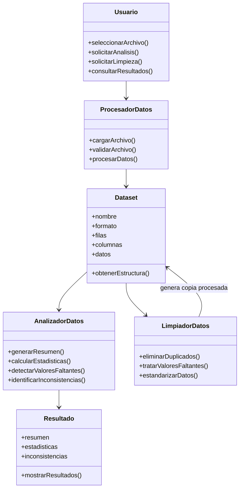
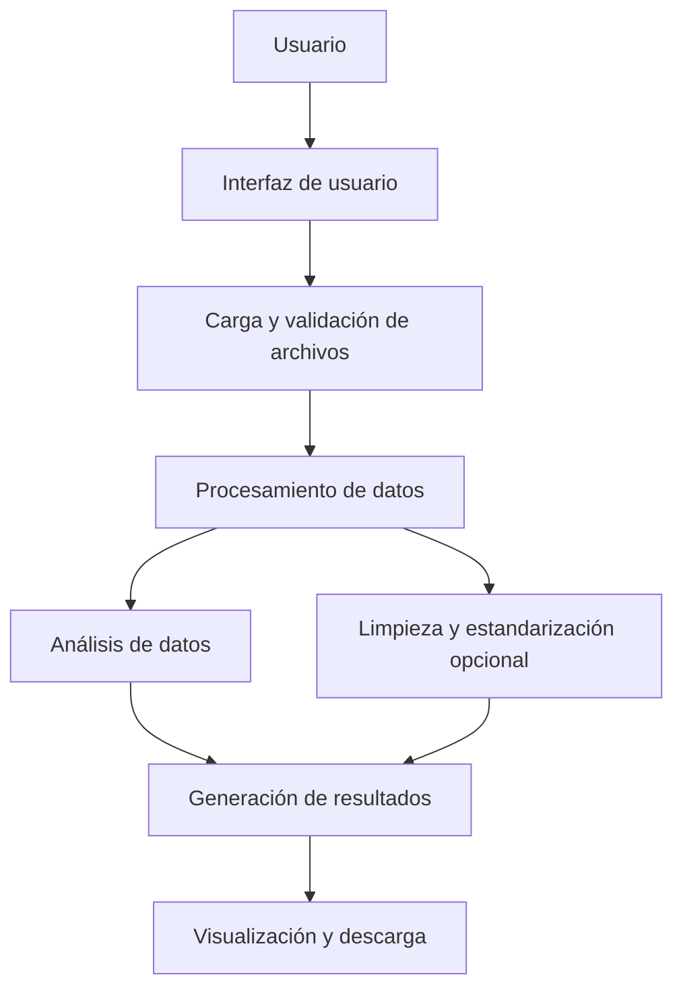
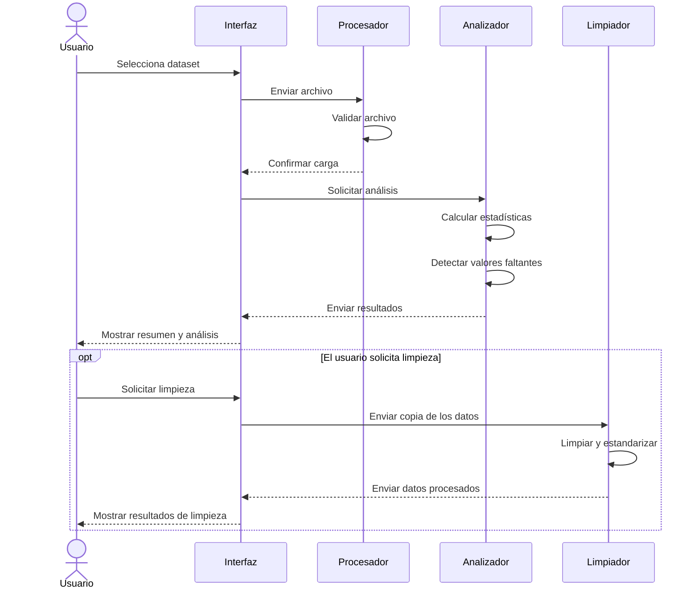

# PRÁCTICA 8. MODELADO UML DEL SISTEMA

**Proyecto:** Datermos  
**Nombre:** Plataforma de Procesamiento, Estandarización y Análisis de Datos  
**Asignatura:** Ingeniería de Software  
**Unidad:** 1. Cierre Sumativo  
**Documento:** Modelado UML  
**Versión:** 1.0  
**Fecha:** 21/10/2026  

---

## 1. Introducción

El presente documento describe el modelado UML de Datermos, una plataforma orientada al procesamiento, estandarización y análisis de conjuntos de datos.

El modelado permite representar visualmente la estructura del software, la organización de sus componentes y la interacción entre el usuario y el sistema.

Para este propósito se utilizan diagramas UML que sirven como referencia durante las etapas de diseño y desarrollo.

## 2. Objetivo del modelado

Representar la estructura y el funcionamiento de Datermos mediante diagramas que permitan comprender cómo se organizan sus módulos, cuáles son sus responsabilidades y cómo se relacionan entre sí.

## 3. Arquitectura general del sistema

Se propone una arquitectura modular dividida en cuatro partes principales:

1. **Interfaz de usuario:** permite cargar archivos y consultar resultados.
2. **Procesamiento de datos:** realiza la lectura y preparación de los datasets.
3. **Análisis de datos:** genera estadísticas, resúmenes e identifica posibles inconsistencias.
4. **Limpieza y estandarización:** aplica modificaciones opcionales sobre una copia de los datos.

Esta organización busca facilitar el mantenimiento, las pruebas y la incorporación de nuevas funcionalidades.

## 4. Diagrama de clases

### 4.1 Descripción

El diagrama de clases representa las principales clases propuestas para Datermos, sus atributos, métodos y relaciones.

Las clases permiten organizar las responsabilidades del sistema de la siguiente manera:

- **Usuario:** representa a la persona que utiliza la plataforma.
- **Dataset:** almacena la información del conjunto de datos cargado.
- **ProcesadorDatos:** administra la lectura y preparación de los archivos.
- **AnalizadorDatos:** obtiene estadísticas y genera resúmenes.
- **LimpiadorDatos:** realiza operaciones opcionales de limpieza.
- **Resultado:** representa la información obtenida durante el análisis.

### 4.2 Representación UML

## 5. Diagrama de componentes

### 5.1 Descripción

El diagrama de componentes muestra cómo se divide Datermos en módulos que trabajan de manera conjunta.

Cada componente tiene una responsabilidad específica:

- **Interfaz:** recibe las acciones del usuario.
- **Carga de archivos:** permite seleccionar y validar datasets.
- **Procesamiento:** prepara los datos para su análisis.
- **Análisis:** genera estadísticas y resúmenes.
- **Limpieza:** realiza operaciones opcionales.
- **Presentación:** muestra los resultados obtenidos.

### 5.2 Representación UML

## 6. Diagrama de secuencia

### 6.1 Descripción

El diagrama de secuencia representa la interacción entre el usuario y los componentes del sistema durante el análisis de un dataset.

El proceso comienza cuando el usuario selecciona un archivo. Posteriormente, el sistema valida su contenido, procesa la información y genera los resultados.

La limpieza se considera una operación opcional que solo se ejecuta cuando el usuario la solicita.

### 6.2 Representación UML

## 7. Relación entre los diagramas

Los tres diagramas representan diferentes perspectivas del mismo sistema:

| Diagrama | Propósito | Aplicación en Datermos |
|---|---|---|
| Clases | Representar la estructura interna. | Define las clases y sus responsabilidades. |
| Componentes | Mostrar la organización modular. | Identifica los módulos principales. |
| Secuencia | Representar las interacciones. | Explica el proceso de análisis y limpieza. |

En conjunto, permiten comprender tanto la organización interna como el comportamiento general de la plataforma.

## 8. Consideraciones de diseño

Para el desarrollo de Datermos se consideran los siguientes principios:

- **Modularidad:** separar las funciones para facilitar su mantenimiento.
- **Reutilización:** utilizar funciones que puedan aprovecharse en diferentes operaciones.
- **Integridad de datos:** conservar los archivos originales.
- **Separación de responsabilidades:** evitar que un solo módulo realice todas las operaciones.
- **Escalabilidad:** permitir incorporar nuevos formatos y funciones en versiones posteriores.

Los diagramas representan una propuesta de diseño y podrán actualizarse conforme avance la implementación.

## 9. Conclusión

El modelado UML permite establecer una representación visual de la estructura y el funcionamiento de Datermos antes de completar su desarrollo.

El diagrama de clases define los elementos principales del sistema, el diagrama de componentes muestra la organización de sus módulos y el diagrama de secuencia describe la interacción durante el análisis de un dataset.

Este modelado servirá como referencia para implementar la plataforma de manera organizada, facilitando la integración, las pruebas y el mantenimiento del software.